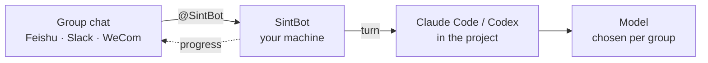

<p align="center">
  <a href="https://sintbot.com"></a>
</p>

<p align="center"><b>Say it in the group. Any model, one memory. On your own machine.</b></p>

<p align="center">
  <a href="https://www.npmjs.com/package/sintbot"></a>
  <a href="https://github.com/WaterTian/sintbot/actions/workflows/test.yml"></a>
  
  <a href="./LICENSE"></a>
</p>

<p align="center">
  <a href="https://sintbot.com">Website</a> ·
  <a href="./README.zh-CN.md">简体中文</a> ·
  <a href="./docs/install.md">Install guide</a> ·
  <a href="https://github.com/WaterTian/sintbot/releases">Releases</a>
</p>

---

SintBot is a self-hosted daemon that puts a coding agent in your team's group chat. You bind a group to a project directory, and then anyone in that group can hand it work. It reads and changes code, designs, runs scripts and reports back, all on your own machine.

Each turn runs the official **Claude Code** or **Codex** CLI headless, so tools, MCP servers, skills and project memory behave just as they do in your terminal. Each group chooses its model: Claude, GPT, DeepSeek, GLM, MiniMax, Kimi, or one you host yourself.

## How it works



- **One group, one project.** Each group gets its own project directory, session, queue, permissions and scheduled tasks.
- **Same agent, any brain.** Switch models with `/model` in the chat. The project's `CLAUDE.md`, `AGENTS.md` and memory carry over to whichever agent runs next.
- **Stays on your machine.** Projects, sessions, memory and logs live on your disk and never pass through a SintBot server. Prompts and the code the model reads still go to the provider you chose.
- **No public IP.** Every platform uses an outbound long connection (Socket Mode on Slack). One daemon can serve Feishu, Slack and WeCom at the same time.

## Quick start

**1. Create a bot and add it to a group.** Step-by-step guides: [Feishu](./docs/platforms/feishu.md) · [Slack](./docs/platforms/slack.md) · [WeCom](./docs/platforms/wecom.md).

**2. Install** on macOS or Linux:

```bash
curl -fsSL https://sintbot.com/install.sh | bash
```

The script checks for Node.js 22+, installs sintbot, runs the setup wizard and offers to install the background service. It asks before every change and never uses `sudo`. Read [install.sh](./install.sh) first, or add `--dry-run` to see what it would do.

To install by hand instead:

```bash
npm i -g sintbot
sintbot setup             # guided setup, with a live trial turn of your model
sintbot service install   # restarted on crash, started at login
```

**3. @ the bot in your group.** Bind more groups, switch models and watch live activity in the local console at http://127.0.0.1:4600.

### Pick a model: no Claude subscription needed

The wizard checks what this machine is logged in to and recommends in this order:

| You have | Use | What to do |
|---|---|---|
| A Claude subscription (Pro / Max) | Claude | run `claude auth login` before the wizard |
| A ChatGPT account | GPT, via Codex | `npm i -g @openai/codex`, then `codex login` |
| Neither | **DeepSeek** (recommended) | sign up at [platform.deepseek.com](https://platform.deepseek.com), top up, create an API key and paste it into the wizard; it runs a trial turn on the spot |

The other presets are Zhipu GLM, MiniMax and Volcano Ark. For GLM and MiniMax, the wizard asks whether your key comes from the mainland-China site or the international one (Z.ai, minimax.io). Kimi and any other Anthropic-compatible endpoint can be added as custom endpoints in the console.

Without a Claude subscription, Claude Code is only the agent framework and needs no login. The only features you lose are GPT groups and image generation, both of which borrow Codex. In mainland China, see the [Chinese README](./README.zh-CN.md#在中国大陆).

## What you get

| Area | What it does |
|---|---|
| **In the group** | Streaming progress: Feishu cards update in place; Slack shows its native "Working…" status and a Stop button. Messages that arrive mid-turn are merged into the next turn. |
| **Commands** | `/help` · `/status` · `/model <name>` · `/stop` · `/skip` · `/new` · `/hud` · `/issue`. On Slack, use a `!` prefix because Slack consumes messages that start with `/`. |
| **Permissions** | Set per group, read-only by default. Thirteen secret and PII patterns are masked before a message reaches the group. |
| **Scheduled tasks** | Cron, aliases such as `daily`, or plain "every day at 09:00". A task can wake the agent, post a reminder or run a script. |
| **Design** | A per-project `DESIGN.md` style file the agent must read. Sixteen built-in styles. A check before every hand-off. Iterate by annotating Feishu whiteboards. |
| **Images** | Generated with the machine's Codex subscription, so no API key is needed. Edit an existing image, repaint a masked region, or produce a transparent background. |
| **Previews & browser** | HTML prototypes are served on your LAN for the group to see. When the bot's browser hits a login or captcha, a group member takes over through a one-time link. |
| **Console** | One local page for every group: projects, models, permissions, design library, live activity and release history. Available in English or Chinese. |
| **Operations** | Turns are capped at 30 minutes, and at most two run at once. Turns interrupted by a restart are redone automatically. Includes `sintbot doctor`, an ops alert group and quota warnings. |

<p align="center"></p>

## Everyday commands

```bash
sintbot doctor                    # health check: config, CLIs, models, platforms, groups
sintbot service status | logs     # is the service up, and what is it doing
sintbot agent run "…"             # a read-only trial turn in the current directory
sintbot ui                        # open the console
sintbot chat -C <project-dir>     # simulate group messages in the terminal, no chat platform needed
sintbot help                      # all commands
```

Configuration lives in `~/.sbot/config.json`. See [docs/config.md](./docs/config.md) for the fields, or the annotated [sbot.config.example.json](./sbot.config.example.json). The package installs two equivalent commands, `sintbot` and `sbot`.

## Status

| Area | Status |
|---|---|
| **macOS** | Verified. Real-machine testing covered the main flows on Feishu and Slack: messaging, streaming progress, model switching and scheduled tasks. |
| **Linux** | Experimental. The systemd unit is covered by unit tests but has not yet been installed on real hardware. |
| **Windows** | Not verified. Install manually; `sintbot service install` prints the NSSM and pm2 commands to run. |
| **WeCom** | The newest integration, with the least real-world use. |
| **Slack** | The native Stop button, `!status` and the thread buttons are covered by tests but have had little real-world use. |

"Feishu" here means the China edition (open.feishu.cn); the international Lark has not been tested. The bot's built-in messages, the setup wizard and `sintbot doctor` are in Chinese; the console has an English mode.

## Security

- The bot **executes commands** in the bound project directory. Permissions are set per group: read-only by default, with "full access" for groups you trust. File tools are confined to the project directory; shell commands are not sandboxed. See [docs/security.md](./docs/security.md).
- The console listens on this machine only. Before opening it to your LAN, run `sintbot ui --set-password`.
- Serving a multi-user group from a personal Claude or ChatGPT subscription may conflict with the provider's terms. For team use, choose API billing or a plan that permits it.

## FAQ

<details>
<summary><b>Do I need a Claude subscription?</b></summary>

No. If the wizard finds no Claude or Codex login, it recommends DeepSeek and runs a trial turn as soon as you paste the API key. Claude Code is still the agent framework; it just needs no login.
</details>

<details>
<summary><b>Can I use it in mainland China?</b></summary>

Yes. Use Feishu as the chat platform and DeepSeek (or the mainland sites of Zhipu GLM or MiniMax) as the model: they connect directly, with no proxy. A proxy is needed only for Claude, ChatGPT or Slack.
</details>

<details>
<summary><b>Do I need a server or a public IP?</b></summary>

No. SintBot runs on a computer you keep on; a Mac is the tested setup. It only makes outbound connections: a WebSocket long connection for Feishu, Socket Mode for Slack and a long connection for WeCom. The console stays local unless you open it.
</details>

<details>
<summary><b>Does switching models lose the project's memory?</b></summary>

No. A switch starts a fresh conversation, but the project's `CLAUDE.md`, `AGENTS.md` and memory directory are handed to whichever agent runs next. Long sessions are compacted automatically.
</details>

<details>
<summary><b>How is it different from cc-bot?</b></summary>

Both are free and MIT-licensed. [cc-bot](https://github.com/WaterTian/cc-bot) is a Claude Code plugin: it runs inside your own interactive session, on that session's model. SintBot is a standalone daemon: no one has to keep a terminal open, each group has its own project, model and permissions, it drives both Claude Code and Codex, and it comes with a local console.
</details>

## Documentation

The feature deep dives marked "(zh)" are in Chinese for now; each English doc links to its Chinese version.

| Topic | Docs |
|---|---|
| Getting started | [Install](./docs/install.md) · [Models](./docs/models.md) · [Configuration](./docs/config.md) · [Security](./docs/security.md) · [Features](./docs/features.md) |
| Chat platforms | [Feishu](./docs/platforms/feishu.md) · [Slack](./docs/platforms/slack.md) · [WeCom](./docs/platforms/wecom.md) |
| Features | [Whiteboard](./docs/BOARD.md) (zh) · [Previews](./docs/PREVIEW.md) (zh) · [Browser](./docs/BROWSER.md) (zh) · [Icons](./docs/ICONS.md) (zh) · [Codex runner](./docs/CODEX-RUNNER.md) (zh) · [Public console access](./docs/PUBLIC-ACCESS.md) (zh) |
| Project | [Architecture (DESIGN.md)](./DESIGN.md) (zh) · [Contributing](./CONTRIBUTING.md) · [Changelog](./CHANGELOG.en.json) |

## Feedback

Please report bugs and request features in [GitHub Issues](https://github.com/WaterTian/sintbot/issues). Include the following, with secrets redacted:

- `sintbot version`
- your OS
- your chat platform
- the output of `sintbot doctor`

Report security issues privately through [GitHub Security Advisories](https://github.com/WaterTian/sintbot/security/advisories/new); see [SECURITY.md](./SECURITY.md).

## License

[MIT](./LICENSE) © WaterTian
