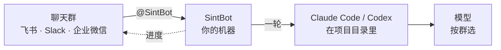

<p align="center">
  <a href="https://sintbot.com/zh/"></a>
</p>

<p align="center"><b>一群一项目,一句话就开工;模型随时换,记忆不丢;全程在你自己的机器上。</b></p>

<p align="center">
  <a href="https://www.npmjs.com/package/sintbot"></a>
  <a href="https://github.com/WaterTian/sintbot/actions/workflows/test.yml"></a>
  
  <a href="./LICENSE"></a>
</p>

<p align="center">
  <a href="https://sintbot.com/zh/">官网</a> ·
  <a href="./README.md">English</a> ·
  <a href="./docs/zh-CN/install.md">安装说明</a> ·
  <a href="https://github.com/WaterTian/sintbot/releases">版本发布</a>
</p>

---

SintBot 是一个跑在你自己机器上的守护进程,把能写代码的 AI 放进团队的聊天群。一个群绑一个项目目录,群里谁都能派活。它会读代码、改代码、做设计、跑脚本、回报结果,全程在你自己的机器上。

每一轮都用官方的 **Claude Code** 或 **Codex** 命令行无头运行,所以工具、MCP、skills、项目记忆都和你在终端里用的一样。模型按群选:Claude、GPT、DeepSeek、GLM、MiniMax、Kimi,或你自己部署的模型。

## 怎么跑



- **一群一项目。** 每个群各有自己的项目目录、会话、排队、权限和定时任务。
- **同一套 agent,任意大脑。** 群里发 `/model` 就能换模型。项目的 `CLAUDE.md`、`AGENTS.md` 和记忆目录会交给接下来运行的 agent。
- **数据留在本机。** 项目、会话、记忆、日志都在你自己的硬盘上,不经过任何 SintBot 服务器。提示词和模型读到的代码照常发给你选的模型服务商。
- **不要公网 IP。** 每个平台都是机器主动往外连的长连接(Slack 用 Socket Mode)。一个守护进程可以同时接飞书、Slack、企业微信。

## 快速开始

**1. 建好机器人,拉进一个群。** 分步说明:[飞书](./docs/zh-CN/platforms/feishu.md)(在中国大陆推荐)· [Slack](./docs/zh-CN/platforms/slack.md) · [企业微信](./docs/zh-CN/platforms/wecom.md)。

**2. 安装**(macOS / Linux):

```bash
curl -fsSL https://sintbot.com/install.sh | bash
```

脚本会检查并装好 Node.js 22+、装 sintbot、跑配置向导,最后问要不要装成常驻服务。每一步先问再动,不用 `sudo`。可以先读 [install.sh](./install.sh),或加 `--dry-run` 只看它会做什么。

也可以手动装:

```bash
npm i -g sintbot
sintbot setup             # 配置向导,会当场试跑一轮你选的模型
sintbot service install   # 崩溃自动拉起、登录后自启
```

**3. 在群里 @ 机器人。** 本地控制台在 http://127.0.0.1:4600,可以绑更多群、切模型、看实时活动。

### 选模型:没有 Claude 订阅也能用

向导会先看这台机器登录了什么,按这个顺序推荐:

| 你有 | 用 | 要做的 |
|---|---|---|
| Claude 订阅(Pro / Max) | Claude | 跑向导前先 `claude auth login` |
| ChatGPT 账号 | GPT(经 Codex) | `npm i -g @openai/codex`,再 `codex login` |
| 都没有 | **DeepSeek**(推荐) | 到 [platform.deepseek.com](https://platform.deepseek.com) 注册、充值、创建 API key,在向导里粘贴,当场试跑一轮 |

其他预设有智谱 GLM、MiniMax、火山方舟。智谱和 MiniMax 会问 key 是在中国大陆站还是国际站(Z.ai、minimax.io)开的。Kimi 等任何 Anthropic 兼容端点,都可以在控制台作为自定义端点添加。

没有 Claude 订阅时,Claude Code 只是执行框架,不用登录。用不了的只有 GPT 群和生图,这两样借的是 Codex。

### 在中国大陆

- **聊天平台用飞书。**
- **模型**:没有 Claude 订阅就用 DeepSeek(或智谱 / MiniMax / 火山方舟的中国大陆站),直连,不用代理。向导问「这台机器在中国大陆吗」时答「是」:只有用到 Claude / ChatGPT 才会问代理。
- **开着全局代理(梯子)的话**,把模型域名设成直连。否则请求绕到境外再回来,又慢又可能触发风控,见 [install.md「代理」](./docs/zh-CN/install.md#代理)。
- **npm 慢**:一键安装和向导会自动换 `registry.npmmirror.com`;手动装加 `--registry https://registry.npmmirror.com`。
- **GitHub 打不开**:中文介绍和安装步骤在[官网](https://sintbot.com/zh/)上都有。

## 能做什么

| 方面 | 说明 |
|---|---|
| **群里** | 进度实时流式更新:飞书卡片原地刷新,Slack 显示原生「Working…」状态和 Stop 按钮。跑着时来的消息,会合并进下一轮。 |
| **命令** | `/help` · `/status` · `/model <名字>` · `/stop` · `/skip` · `/new` · `/hud` · `/issue`。Slack 会吃掉 `/` 开头的消息,所以在 Slack 里用 `!` 前缀。 |
| **权限** | 按群设,默认只读。消息到群之前先遮掉 13 类密钥与隐私信息。 |
| **定时任务** | cron、`daily` 这类别名,或直接写「每天 09:00」。到点可以叫醒 agent、只发提醒,或只跑一个脚本。 |
| **设计** | 每个项目一份 agent 必读的风格档 `DESIGN.md`,16 套内置风格,交付前先核对。还可以在飞书画板上标注、迭代。 |
| **生图** | 借本机的 Codex 订阅生图,不用 API key。可以在原图上改、遮罩局部重绘、透明底。 |
| **预览与浏览器** | 把 HTML 原型挂到局域网给群成员看。机器人的浏览器碰到登录或验证码时,群成员用一次性链接接管。 |
| **控制台** | 一个本地网页管所有群:项目、模型、权限、设计库、实时活动、版本历史。界面中英文可切。 |
| **运维** | 每轮最长 30 分钟,全局最多同时两轮。被重启打断的轮次会自动重做。另有 `sintbot doctor` 体检、运维告警群、额度提醒。 |

<p align="center"></p>

## 常用命令

```bash
sintbot doctor                    # 体检:配置、命令行工具、模型、平台、群绑定
sintbot service status | logs     # 服务在不在、在做什么
sintbot agent run "…"             # 在当前目录只读试跑一轮
sintbot ui                        # 打开控制台
sintbot chat -C <项目目录>         # 不接聊天平台,在终端里模拟群消息
sintbot help                      # 全部命令
```

配置在 `~/.sbot/config.json`,字段说明见 [docs/config.md](./docs/zh-CN/config.md),带注释的完整示例见 [sbot.config.example.json](./sbot.config.example.json)。npm 包装出两个同义命令:`sintbot` 和 `sbot`。

## 验证现状

| 方面 | 现状 |
|---|---|
| **macOS** | 已验证。飞书与 Slack 的主流程都真机验过:收发消息、流式进度、换模型、定时任务。 |
| **Linux** | 实验性。systemd 单元文件有单元测试覆盖,还没在真机上装过。 |
| **Windows** | 未验证。手动安装;`sintbot service install` 会打印 NSSM 与 pm2 的现成命令。 |
| **企业微信** | 三个平台里最新接入的,真实环境里用得最少。 |
| **Slack** | 原生 Stop 按钮、`!status`、线程里的按钮有测试覆盖,但真实环境里用得还少。 |

这里的飞书指中国版(open.feishu.cn),国际版 Lark 没有测过。欢迎试用后反馈。

## 安全须知

- 机器人能在绑定的项目目录里**执行命令**。权限按群设:默认只读;「完全访问」只给你信任的群。文件工具限制在项目目录内,命令行没有沙箱。详见 [docs/security.md](./docs/zh-CN/security.md)。
- 控制台默认只听本机。要给局域网用,先 `sintbot ui --set-password`。
- **订阅条款**:用个人的 Claude / ChatGPT 订阅登录来服务多人群聊,可能不符合提供方的使用条款。团队使用请改用 API 计费或允许这种用法的账号类型,并自行确认合规。

## 常见问题

<details>
<summary><b>必须有 Claude 订阅吗?</b></summary>

不需要。向导没检测到 Claude 或 Codex 登录时,会推荐 DeepSeek,粘贴 API key 后当场试跑一轮。执行框架仍是 Claude Code,只是不用登录。
</details>

<details>
<summary><b>在中国大陆能用吗?</b></summary>

能。聊天平台用飞书,模型用 DeepSeek(或智谱 GLM、MiniMax、火山方舟的中国大陆站),都是直连、不用代理。只有用 Claude、ChatGPT 或 Slack 才需要代理。
</details>

<details>
<summary><b>需要服务器或公网 IP 吗?</b></summary>

不需要。它跑在一台你一直开着的电脑上(Mac 是验证过的环境),只向外连接:飞书用 WebSocket 长连接,Slack 用 Socket Mode,企业微信用长连接。控制台默认只在本机,除非你自己选择开放。
</details>

<details>
<summary><b>换模型会丢掉项目记忆吗?</b></summary>

不会。换模型会开一段新对话,但项目里的 `CLAUDE.md`、`AGENTS.md` 和记忆目录会交给接下来运行的 agent。长会话会自动压缩。
</details>

<details>
<summary><b>它和 cc-bot 有什么区别?</b></summary>

两者都免费、都是 MIT 许可。[cc-bot](https://github.com/WaterTian/cc-bot) 是 Claude Code 插件,运行在你自己的交互会话里,用的就是该会话的模型。SintBot 是独立的守护进程:不需要有人守着终端,每个群有自己的项目、模型和权限,同时驱动 Claude Code 和 Codex,并自带本地控制台。
</details>

## 文档

| 主题 | 文档 |
|---|---|
| 上手 | [安装](./docs/zh-CN/install.md) · [模型](./docs/zh-CN/models.md) · [配置](./docs/zh-CN/config.md) · [安全](./docs/zh-CN/security.md) · [功能详解](./docs/zh-CN/features.md) |
| 聊天平台 | [飞书](./docs/zh-CN/platforms/feishu.md) · [Slack](./docs/zh-CN/platforms/slack.md) · [企业微信](./docs/zh-CN/platforms/wecom.md) |
| 功能 | [画板](./docs/BOARD.md) · [预览](./docs/PREVIEW.md) · [浏览器](./docs/BROWSER.md) · [图标](./docs/ICONS.md) · [Codex 后端](./docs/CODEX-RUNNER.md) · [控制台公网访问](./docs/PUBLIC-ACCESS.md) |
| 项目 | [架构与设计(DESIGN.md)](./DESIGN.md) · [参与开发](./CONTRIBUTING.zh-CN.md) · [更新日志](./CHANGELOG.json) |

## 反馈

碰到问题或想要新功能,请到 [GitHub Issues](https://github.com/WaterTian/sintbot/issues) 提。请附上以下信息,贴之前先遮掉密钥:

- `sintbot version`
- 系统
- 聊天平台
- `sintbot doctor` 的输出

安全问题请通过 [GitHub 私密漏洞报告](https://github.com/WaterTian/sintbot/security/advisories/new)私下提交,别发公开 issue,详见 [SECURITY.md](./SECURITY.zh-CN.md)。

## 许可

[MIT](./LICENSE) © WaterTian
